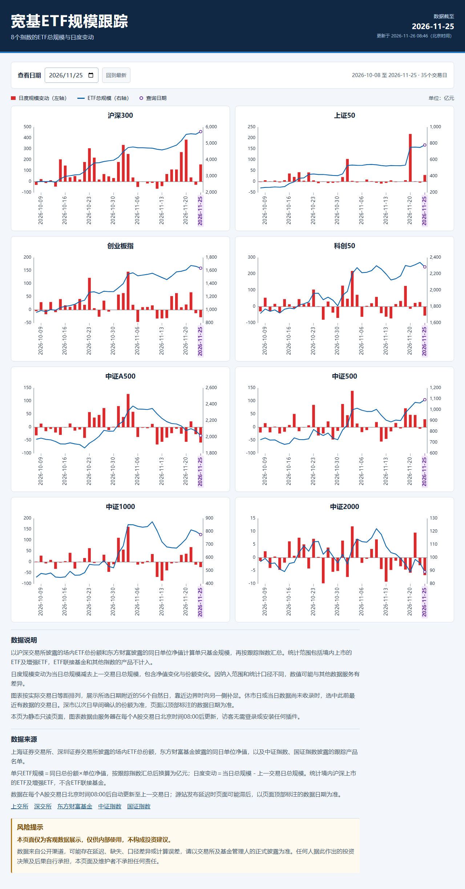
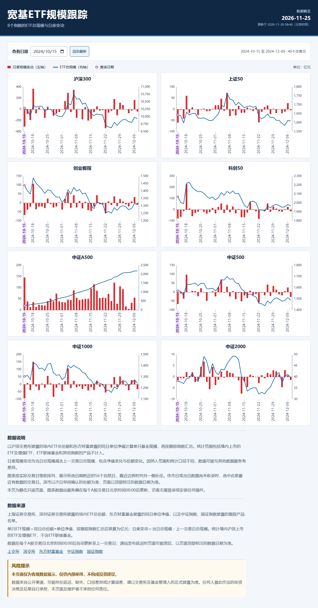
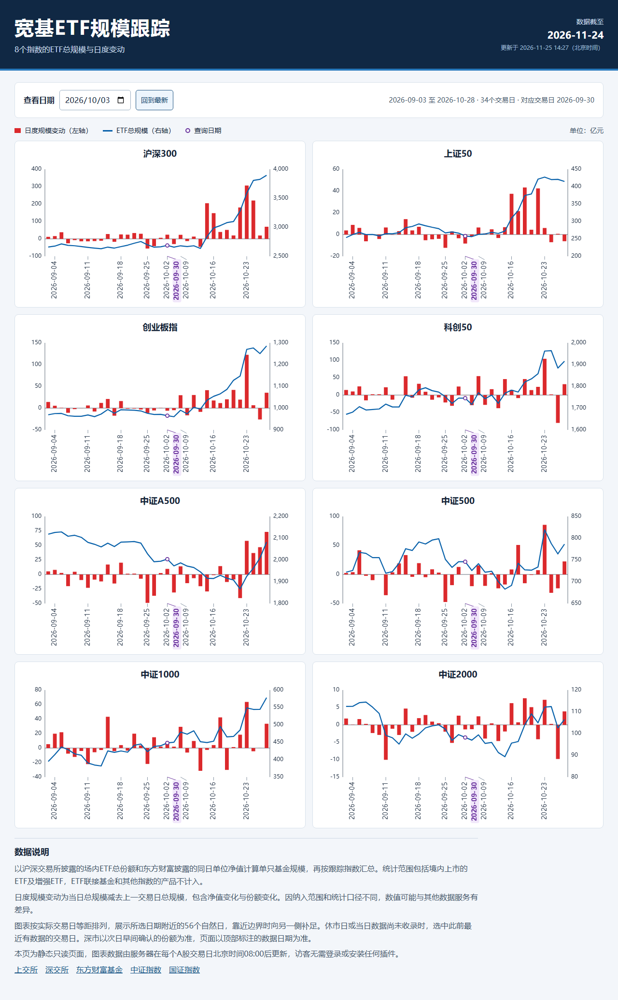
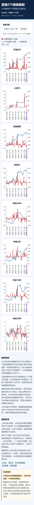

# 宽基ETF规模跟踪（中国大陆直连版）

静态网页 + 同源只读 JSON + 服务器定时更新脚本。访客用大陆普通宽带或手机流量即可打开，
不需要代理、ChatGPT 账号、iFinD 账号，也不加载任何海外前端资源。

- 数据截至：**2026-11-25**，共 **515 个交易日**（2024-10-15 起）。
- 默认展示最新交易日；日期可选 **2024-10-15 至北京时间当天**；休市日映射到此前最近有数据的交易日。
- 图表为 56 个自然日窗口，只画实际交易日；周五刻度显示完整日期；查询日用紫色空心圆和紫色粗体日期，图内无竖线。
- 八张图：沪深300、上证50、创业板指、科创50、中证A500、中证500、中证1000、中证2000。
- 页面底部有“数据来源”和“风险提示”两段说明（仅为客观数据展示、仅供内部使用、不构成投资建议）。

在线预览（GitHub Pages，静态快照）：**https://huangqizhuo-ecnu.github.io/wide-etf-dashboard/**



### 历史范围说明

- **2024-10-15** 是八个指数都有 ETF 份额的最早交易日，因此作为完整八图的历史起点。
- 深交所 ETF 月报最早覆盖 2017-01，上交所 ETF 份额可查更早（2013 年已有数据）；但科创50 ETF 2020-09 上市、中证2000 ETF 2023-09 上市、中证A500 ETF 2024-10-15 才首次出现在交易所份额报表。
- 若要继续往 2017 年回溯，需要允许部分指数在尚未发行 ETF 的日期显示“当时尚无 ETF”，属于前端空值展示改造；当前版本优先保证八张图口径一致。

## 本地运行

需要 Python 3.10 或以上（仅标准库，无需安装依赖）。

```powershell
Set-Location -LiteralPath 'C:\Users\32046\Desktop\实习\宽基etf\etf-cn-dashboard'
python scripts/serve.py
```

浏览器打开 `http://127.0.0.1:8080/`，数据地址为 `http://127.0.0.1:8080/api/history`。
手机用同一 Wi-Fi 调试时，可加 `--host 0.0.0.0`，再用电脑的局域网 IP 访问。

服务器只读：`GET`/`HEAD` 之外的请求返回 405，`/api/history` 与 `/api/history.json` 均为 `no-store`。

## 日常更新

```powershell
# 按北京时间补齐到最近一个已结束自然日（默认昨天），自动跳过休市日
python update_daily.py

# 指定截止日做人工补跑；漏跑多个交易日时一次补齐
python update_daily.py --through 2026-11-25

# 本机若设置了不可用的代理变量，强制直连公开源
python update_daily.py --direct

# 不取数，只校验并重新发布当前内部快照（首次部署或回滚后使用）
python update_daily.py --publish-only

# 只看校验结果，不写对外 JSON
python update_daily.py --dry-run
```

脚本行为：

1. 按 Asia/Shanghai 判断当天是否为 A 股交易日，周末和法定休市日直接跳过（周末不联网）；交易日历读取失败时同样有界重试。
2. 进程级互斥锁，定时任务与人工补跑不会并发写同一份数据。
3. 调用 `refresh_public_etf.py` 从公开源补齐快照之后的全部交易日，默认最多重试 3 次、间隔 120 秒。
4. 校验八指数顺序、日期递增无周末、只追加不篡改历史（历史值允许 1e-6 亿元以内的重复取数舍入差异）、总规模为正、日度变动等于相邻规模差。
5. 备份上一版对外 JSON（保留最近 40 份），同目录临时文件 + 原子替换，再回读核对。
6. 源站数据未齐、校验失败或断网时**保留上一版**，原因写入 `logs/update.log` 与 `logs/update.jsonl`，退出码 1。

## 目录结构

| 路径 | 用途 |
| --- | --- |
| `public/` | 部署到 Web 根目录的静态文件（`index.html`、`style.css`、`dashboard.js`、`window.js`） |
| `public/api/history.json` | 对外只读 JSON，由 `update_daily.py` 原子发布；不含内部字段 |
| `data/history.json` | 历史快照（515 个交易日，2024-10-15 至 2026-11-25；原 2026 快照保留在 `data/backups/`） |
| `data/index-members.json` | 已验证的历史 ETF 产品代码，防止当前名单漏掉历史产品 |
| `data/current/history.json` | 内部工作快照，保留 `last_members`，只由更新程序读写 |
| `data/backups/` | 对外 JSON 的历史版本，用于回滚 |
| `logs/update.log`、`logs/update.jsonl` | 人读日志与结构化运行记录 |
| `refresh_public_etf.py` | 公开源取数、核验、历史重建（原程序原样复用） |
| `update_daily.py` | 交易日历、互斥、重试、校验、备份、原子发布、回读 |
| `scripts/serve.py` | 本地预览服务器（生产使用 Nginx） |
| `deploy/` | Nginx、systemd、cron、Windows 计划任务配置 |
| `tests/` | 前端逻辑、浏览器渲染、更新流程的验收脚本与截图 |
| `部署说明.md` | 大陆主机部署、权限、定时任务与直连实测清单 |

## 验收命令与结果

本机（Windows，Python 3.13.14，Node.js 24.21.0 仅用于测试）实测通过：

```powershell
python scripts/serve.py                                  # 本地看板
node tests/verify_frontend.mjs                           # 12567 项逻辑与数据检查
node tests/browser-check.mjs                             # 8 张 Canvas 渲染、紫色标记、休市映射、320px 布局
python tests/test_update_daily.py                        # 21 项更新/发布流程测试
```

- `tests/verify_frontend.mjs`：扩展后的查询样例（2024-10-14→2024-10-15、2025-01-02→36 点、2026-01-01→2025-12-31→38 点、2026-07-24→40 点）全部一致；全部 515 个交易日窗口自洽；周五刻度全部为完整日期。
- `tests/browser-check.mjs`：真实 Chrome 渲染 8 张图；最新日与休市日（2026-10-03→2026-09-30）都有紫色空心圆；图内无竖线；悬停提示显示实际交易日期与两项数值；页面底部显示“数据来源”和“风险提示”；320px 单列且无横向溢出。截图见 `docs/screenshots/`。
- `python tests/test_update_daily.py`：只追加、拒绝改写历史、拒绝周末/乱序/负规模/错误变动、并发锁、残留锁回收、源站失败保留旧版、一次补齐漏跑交易日、重复执行不重复追加，全部通过。
- 公开源直连（关闭代理）：2026-11-21 快照补齐到 2026-11-24 的实测结果与已验收快照逐值一致（2026-11-24 完全相同，2026-11-23 最大差 1e-8，属 8 位小数舍入）。

### 界面截图

| 桌面 1280px | 期初 2024-10-15 | 休市日查询 | 手机 320px |
| --- | --- | --- | --- |
|  |  |  |  |

## 数据口径

沪深交易所披露的场内 ETF 总份额 × 东方财富披露的同日单位净值，按跟踪指数汇总为亿元；
日度变动为当日总规模减上一交易日总规模，包含净值与份额变化。统计境内沪深上市的 ETF 及增强 ETF，
排除 ETF 联接基金。深市以次日早间确认的份额为准。公开源口径可能与其他数据服务存在差异。

数据来源：[上交所](https://www.sse.com.cn/market/funddata/volumn/etfvolumn/) ·
[深交所](https://www.szse.cn/market/fund/volume/etf/index.html) ·
[中证指数](https://www.csindex.com.cn/) ·
[国证指数](https://www.cnindex.com.cn/) ·
[东方财富基金](https://fund.eastmoney.com/)

## 自动更新（GitHub Actions，已配置）

- 工作流：`.github/workflows/update-data.yml`
- 外部定时（当前主用）：**cron-job.org** 每个交易日 07:45 / 08:30 / 09:00 调用 GitHub 的 `workflow_dispatch`，不依赖本机开机。三个任务在 2026-11-26 测试运行均返回 204，对应 GitHub Actions 运行全部成功。
- GitHub 自带定时：北京时间 07:45、08:30、09:00（UTC 前一天 23:45、00:30、01:00），单次最多重试 9 次、每次 5 分钟；与 cron-job.org 互为备份，谁先成功谁更新。
- 本机 Windows 任务 `ETF-Dashboard-Dispatch` 只用于 2026-11-26 排查 GitHub 定时未触发的问题；cron-job.org 验证后已移除。`deploy/install-dispatch-task.ps1` 保留为可选备用。
- 令牌：cron-job.org 使用专用 fine-grained token `etf-dashboard-cron`（仅 `Actions: Read and write`，90 天到期需更换）；仓库和本机不保存该令牌。本机旧的 classic token 已删除，并应在 GitHub 设置中吊销。
- 2026-11-26 实测：08:00 的 GitHub `schedule` 事件未产生；11-25 数据于 09:20 手动补跑；随后 cron-job.org 三次测试全部成功（03:00–03:03 UTC，对应 11:00–11:03 北京时间）。
- 流程：查 A 股交易日历 → 休市日跳过 → 更新到上一交易日并一次补齐漏跑 → 校验 → 提交 `data/current/history.json`、`public/api/history.json` 和运行状态 → 推送 `gh-pages` → GitHub Pages 自动重建。
- 实测（2026-11-25）：工作流手动运行成功；`Probe data sources` 工作流在 GitHub 的 Ubuntu runner 上真实抓取 2026-11-23/24（177 只 ETF），当时的快照为 215 个交易日；目前历史已扩展到 515 个交易日（2024-10-15 至 2026-11-25）。
- 失败时保留上一版数据，`data/current/ci-status.json` 记录 `outcome` 与日志尾部，Actions 运行标红；下一个交易日自动重试并补齐。
- 注意：GitHub 定时任务可能延迟；GitHub Pages 的 CDN 在大陆各运营商可达性有差异，正式面向大陆用户时仍建议国内主机 + 备案域名。

## 固定地址（GitHub Pages）

- 页面：**https://huangqizhuo-ecnu.github.io/wide-etf-dashboard/**
- 仓库：https://github.com/huangqizhuo-ecnu/wide-etf-dashboard
- 发布方式：`gh-pages` 分支保存 `public/` 的静态副本，由 GitHub Pages 构建，不依赖 Actions 权限。

更新数据后同步到 Pages（令牌只放环境变量，不要提交）：

```powershell
python update_daily.py
$env:GH_TOKEN = '<具有 repo 权限的令牌>'
python scripts/publish_pages.py --owner huangqizhuo-ecnu --repo wide-etf-dashboard
```

说明：GitHub Pages 是静态快照，数据更新需要再执行一次上面的发布；GitHub 的 CDN 在大陆不同运营商的可达性有差异，
需要稳定的大陆入口时仍按下文用国内主机 + 已备案域名部署。Pages 对 `api/history.json` 有约 10 分钟 CDN 缓存，
前端已加时间戳参数，刷新即可拿到新文件。

## 临时公网预览（无需代理）

没有大陆主机和备案域名时，可用本机 + Cloudflare 快速隧道先得到一个可直接打开的 HTTPS 地址。
当前预览地址（临时，随进程变化）：**https://revealed-tigers-deployment-seeds.trycloudflare.com**

```powershell
# 终端 1：本地看板
python scripts/serve.py --port 8080
# 终端 2：建立隧道，输出里会给出 https://<随机名>.trycloudflare.com
tools\cloudflared.exe tunnel --url http://127.0.0.1:8080 --no-autoupdate --protocol http2
```

`tools\cloudflared.exe` 可从
`https://github.com/cloudflare/cloudflared/releases/latest/download/cloudflared-windows-amd64.exe`
下载，放入 `tools\` 即可（约 55 MB，已加入 .gitignore）。

也可以双击 `start-public-preview.cmd` 一次启动两者。

注意：这是评审用的临时入口，不是正式交付入口——依赖这台电脑和进程常开，重启后网址会变，没有可用性保证。
正式入口仍需大陆主机 + 已备案域名，按 [部署说明.md](部署说明.md) 部署；两者页面与数据完全相同。

## 部署

静态网页 + 同源 JSON，推荐 Nginx + systemd timer（或 cron），详见 [部署说明.md](部署说明.md)。
原项目 `../etf-public-dashboard` 和原始数据均未改动；本目录是独立交付版。
